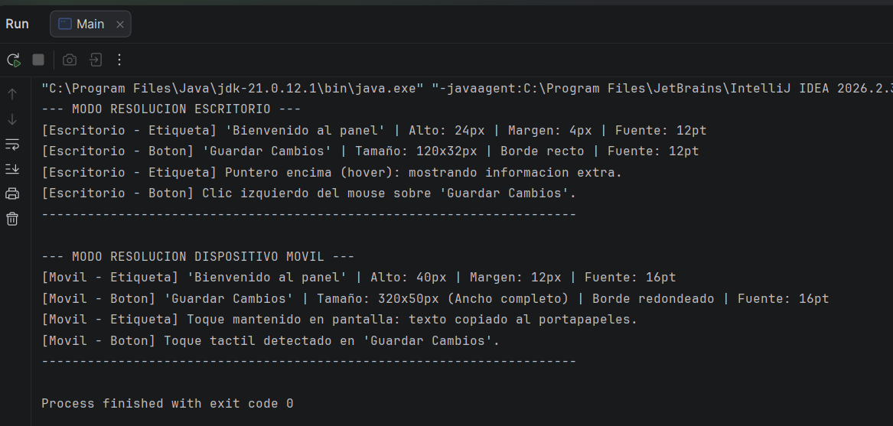

- Diseño de Software - Módulo 3
- Ejercitación 3.E.2 - Patrón Factory Method
Ejercicio 7: Generador de Componentes de Interfaz Gráfica Minimalista
Contexto del problema:
Un framework gráfico ligero necesita renderizar componentes de interfaz (como Botones Interactivos y Etiquetas de Texto) adaptados visualmente a diferentes resoluciones de pantalla (modo Escritorio y modo Dispositivo Móvil).

Objetivo de aprendizaje:
Implementar un Factory Method que coordine la creación de familias de objetos visuales coherentes bajo un entorno con reglas de diseño específicas.

Requisitos funcionales:

Crear componentes gráficos que respondan a eventos de interacción según el modo de pantalla activo.

Asegurar que la factoría construya exclusivamente elementos visuales compatibles entre sí para mantener la coherencia estética.

Restricciones técnicas:

La estructura creadora debe garantizar que los componentes generados mantengan un contrato estricto de renderizado.

Las subclases creadoras deben especializarse en producir componentes con propiedades geométricas homogéneas.
***
# Lógica y Funcionamiento del Programa:
    Para resolver este ejercicio apliqué el patrón Factory Method agrupando la creación de botones y etiquetas por tipo de pantalla, garantizando que todos los elementos dibujados compartan las mismas proporciones y comportamiento.

- Interfaces Boton y Etiqueta: Definen el contrato estricto de renderizado (renderizar()) y los eventos de interacción (hacerClic() e interactuar()).

- Clases BotonEscritorio y EtiquetaEscritorio: Implementan las interfaces con medidas compactas (120x32px, fuente 12pt y bordes rectos) pensadas para monitores, respondiendo a acciones de mouse como clics y eventos hover.

- Clases BotonMovil y EtiquetaMovil: Implementan las interfaces con dimensiones amplias y táctiles (320x50px, fuente 16pt y bordes redondeados) adaptadas a pantallas móviles, respondiendo a toques en pantalla.

- Clase FabricaInterfaz: Es la clase creadora abstracta que declara crearBoton() y crearEtiqueta(), además de un método renderizarPantalla() que arma y prueba ambos controles juntos.

- Clases FabricaEscritorio y FabricaMovil: Son las factorías concretas. Cada una instancia exclusivamente los componentes de su resolución, evitando que se mezclen controles de escritorio con controles móviles.

- Clase Main: Probé ambas fábricas por separado para comprobar que cada entorno renderiza sus componentes con geometría homogénea y ejecuta los eventos que le corresponden.
***
# EjecucionPor consola
